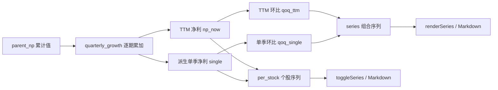

## 产品概述

在现有「近 20 个报告期 TTM 归母净利同比」功能基础上新增环比展示，让用户同时看到每个报告期的同比增长与环比动量变化。

## 核心功能

- 新增两种环比口径并同时展示：
- **单季环比**：单季归母净利 vs 上一单季净利（标准环比，由累计值相减得到单季）
- **TTM 环比**：本期 TTM 归母净利 vs 上一期 TTM 归母净利
- 覆盖三个展示位置：
- 组合增速序列表（新增环比列）
- 个股展开明细（逐期卡片同步显示两种环比）
- 导出 Markdown（财报摘要、组合增速序列、个股逐期增速三处同步加入）
- 环比缺失的边界期（最旧一期/两期）显示为空，不影响现有同比、PEG 等既有计算

## 技术栈

- 后端：Python（现有 `etf_peg/peg.py` 计算引擎，标准库 + 现有 store/datasource 模块）
- 前端：原生 JavaScript + HTML（现有 `web/index.html` 单文件）
- 数据源：复用已入库的累计归母净利 `parent_np` 与 TTM 净利润，无新增网络拉取

## 实现方案

### 总体策略

复用现有 `quarterly_growth()` 的逐期循环，在计算同比的同时额外记录「本期 TTM 净利」与「本期累计归母净利」两个时间序列，循环结束后统一派生环比，避免重复读取财报数据。环比仅作为新增展示字段，不改动 `g`/`g_valid`/PEG 等既有逻辑。

### 计算口径

- 序列顺序由新到旧（`series_bases()` 返回连续报告期，index 0 最新）。
- **TTM 环比**：`(np_now[i] − np_now[i+1]) / |np_now[i+1]| × 100`，最旧一期无值。
- **单季环比**：`single[i] = 累计[i] − 累计[i+1]`，`环比 = (single[i] − single[i+1]) / |single[i+1]| × 100`；最旧两期无值。
- 单季环比仅覆盖 A 股成分（港股为半年度财报，无单季数据）；TTM 环比对 A 股与港股均可用（港股取 `hk_tl` 时间线中的该期 TTM 净利）。
- 环比统一用「全样本」口径（含亏损与负增长），与现有序列展示口径一致。

### 数据流



### 关键接口变更

`quarterly_growth()` 返回结构变更（仅一处调用点，位于 `analyze_etf`）：

- `series` 每项新增：`qoq_ttm`（TTM 环比）、`qoq_single`（单季环比）。
- `per` 由 `{code: [g, ...]}` 改为 `{code: {"yoy": [...], "qoq_ttm": [...], "qoq_single": [...]}}`。

`StockRow` 新增字段：

- `qoq_ttm_series: Optional[List[Optional[float]]]`
- `qoq_single_series: Optional[List[Optional[float]]]`

## 目录结构

```
d:/ETF_Analysis/ETF_Analysis/
├── etf_peg/
│   └── peg.py            # [MODIFY] StockRow 新增环比序列字段；quarterly_growth 计算并返回环比；analyze_etf 传递新字段
└── web/
    └── index.html        # [MODIFY] renderSeries 加环比列；toggleSeries 卡片加环比；Markdown 导出三处加环比
```

### 实现要点

- 环比计算在 `quarterly_growth` 主循环后统一派生，复杂度 O(报告期数 × 成分股数)，无额外网络请求。
- 缺失值（None）在前端统一显示为「—」，颜色规则复用现有同比的绿涨红跌逻辑。
- 单季环比在含港股组合中仅按 A 股成分计算，界面备注说明口径，避免误导。