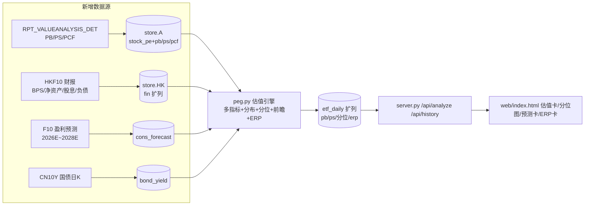

## 产品概述

在现有 ETF PEG 分析工具基础上，补齐一套适用于周期成长行业（如半导体）的完整估值体系，解决"单一 PE/PEG 在周期底部失真"和"PEG 被高增长带偏"两大问题。

## 核心功能

- **多指标估值**：在现有 PE 基础上新增 PB、PS、股息率、现金流估值指标，以及 EV/EBIT（近似口径，界面明示）；周期底部 PE 为负或极高时自动切换参考指标
- **估值分布全景**：中位数、等权平均、加权平均、整体法四种口径并列展示；盈利股与亏损股、正增长与负增长样本分开统计；给出全样本 PEG、亏损股合计权重、负增长股合计权重，量化当前 PEG 的"水分"
- **历史分位**：PE/PB/PS 当前值在近 3/5/8 年历史区间中的分位数，支持互相交叉验证（如 PE 中低位但 PB 高位则提示周期顶部风险）
- **前瞻估值**：接入 2026E/2027E/2028E 机构一致预期净利润，计算前瞻 PE 与前瞻 PEG（当前 PE ÷ 未来 2~3 年预期净利 CAGR），与 TTM PEG 并排对照；一致预期覆盖权重不足时明示
- **股债性价比 / ERP**：基于 10 年期国债收益率计算组合风险溢价（1/PE − 无风险利率）及其历史分位，提供估值中枢参考；信用利差作为可选项
- **可视化呈现**：详情页新增估值指标卡、分位带状图、预测对照卡、股债性价比卡，全部沿用现有界面风格

## 边界说明

- 前瞻预测指标仅覆盖 A 股成分（港股无免费一致预期数据源），界面明示
- A 股历史股息率序列不可得，股息率仅展示当前值；历史分位覆盖 PE/PB/PS
- 历史分位需重拉一次全市场估值历史（含 PB/PS），耗时约 2 小时且支持断点续传

## 技术栈

完全沿用现有栈，零新增依赖：Python 标准库（http.server + urllib + sqlite3）、单文件前端（原生 JS）。数据源全部来自已实测验证的免费东财接口。

## 数据源（已实测验证）

| 数据 | 接口 | 关键字段 |
| --- | --- | --- |
| A 股历史 PB/PS/PCF | `RPT_VALUEANALYSIS_DET`（与现有 PE 同源同行） | PB_MRQ、PS_TTM、PCF_OCF_TTM |
| 港股净资产/股息/EV 材料 | `RPT_HKF10_FN_MAININDICATOR`（与现有港股财报同源） | BPS、TOTAL_PARENT_EQUITY、DIVIDEND_RATE、DPS_HKD、TOTAL_LIABILITIES、END_CASH、OPERATE_PROFIT |
| A 股一致预期 | `emweb.../PC_HSF10/ProfitForecast/PageAjax?code=SH600519` | yctj_chart（PARENT_NETPROFIT 2025A/2026E~2028E + 增速）、jgyc、ycmx（机构明细） |
| 10 年期国债 | push2 `secid=171.CN10Y`（实时）+ push2his 日 K（历史，HTTP/HTTPS 双协议同港股模式） | f43、日 K 收盘 |


## 实施方案（四期递进）

### 一期：数据层扩展 + 估值分布（纯计算，无重初始化）

1. **表结构迁移**（`store.py`，沿用既有 `ALTER TABLE` 先例）：

- `stock_pe` 增列 `pb/ps/pcf`；`fin`（港股）增列 `bps/equity/dividend_rate/dps/total_liab/end_cash/operate_profit`；`etf_daily` 增列 `pb/ps/pe_pct/pb_pct/ps_pct`（旧行 NULL，增量回填）

2. **取数升级**：`fetch_stock_pe`/`ensure_market_pe`（datasource.py）在既有列映射中追加 PB_MRQ/PS_TTM/PCF_OCF_TTM（同一请求零额外开销）；`fetch_hk_financials`（hk.py）追加港股新列，各期财报重拉一遍（约 24 期 × 分页，成本约 10 分钟，走既有"既成事实不重下"逻辑）
3. **计算引擎**（`peg.py`，扩展 `ETFResult`）：

- PB 整体法 = Σ市值 ÷ Σ归母净资产（A 股用 mktcap ÷ (mktcap/PB)反推净资产；港股用 equity），中位数/加权调和/等权并列
- PS 同理（营收 A 股已有、港股 OPERATE_INCOME 已有）；股息率 = Σ近12月分红 ÷ Σ市值（港股 DPS×股本；A 股当前值）
- EV/EBIT：港股材料齐全直接算（EV=市值+总负债−现金，EBIT=营业利润）；A 股需先探测资产负债表接口（`RPT_DMSK_FN_BALANCE`），成本过高则降级为仅港股 + A 股以 PCF 补充，界面明示
- 分布统计：等权 PE、正/负样本分开的整体法与中位数；全样本 PEG；亏损股权重合计、负增长股权重合计、`peg_gap`（有效 PEG − 全样本 PEG，量化水分）

### 二期：历史分位

- `run.py` 新增 `--init-valuation`：按既有 `init_all_stock_pe` 模式重拉全市场历史估值（PB/PS 一并入库），**schema 水位判定**——存量 stock_pe 行无 pb 列数据时自动纳入待拉清单，支持断点续传（约 2 小时）
- 港股 PB 历史 = 日收盘价 ÷ BPS 按报告期阶梯插值（复用 `attach_mktcap` 的股本阶梯模式）
- `backfill_etf` 扩展：逐日组合 PB/PS 序列（每日 Σ市值 ÷ Σ当日 PIT 净资产/营收），写入 etf_daily 新列；分位数在查询时按窗口现算（3/5/8 年）
- 修改计算口径时需 `--clear-history` 强制重算，沿用现有机制

### 三期：前瞻 PE / 前瞻 PEG

- 新建 `etf_peg/forecast.py`（独立模块，物理隔离同 hk.py 惯例）：逐只拉 F10 盈利预测 → 新表 `cons_forecast(code, year, mark, np_mean, np_median, eps, n_org, fetched_at)`，TTL 3 天（预测随研报滚动更新），磁盘缓存 + SQLite 持久
- 前瞻 PE = Σ市值 ÷ Σ一致预期净利(2026E)；前瞻 PEG = 前瞻 PE ÷ CAGR(2026E→2028E)；仅 A 股成分参与，`cons_weight`（一致预期覆盖权重）随结果返回并警示
- 限流下 300 只约 35 秒（首次），之后零网络

### 四期：股债性价比 / ERP

- 新建 `etf_peg/bond.py`：CN10Y 日 K 入库（新表 `bond_yield(date, y10)`，增量拉取，复用 `_kline_request` 双协议模式）
- ERP = 1/组合整体PE − 10Y 收益率，逐日序列（复用 etf_daily 的 pe）+ 历史分位
- 信用利差：探测中债企业债收益率代码，无免费源则不做，界面不预留空位

## 架构与数据流



## 目录结构

```
etf_peg/
├── datasource.py   # [MODIFY] fetch_stock_pe/ensure_market_pe 增映射 PB_MRQ/PS_TTM/PCF_OCF_TTM
├── hk.py           # [MODIFY] fetch_hk_financials 增映射 BPS/净资产/股息/负债/现金/营业利润；PB 历史阶梯
├── store.py        # [MODIFY] stock_pe/fin/etf_daily 表增列迁移；cons_forecast/bond_yield 新表；schema 水位
├── peg.py          # [MODIFY] ETFResult 扩展；PB/PS/股息/EV/等权/正负样本/全样本PEG/水分统计；backfill 扩 PB/PS/分位
├── forecast.py     # [NEW] 一致预期抓取与缓存、前瞻 PE/PEG、覆盖权重
├── bond.py         # [NEW] CN10Y 日K入库、ERP 序列
├── server.py       # [MODIFY] /api/analyze 返回体扩展；/api/job/start 增 initvaluation
web/
└── index.html      # [MODIFY] 估值指标卡、分布统计、分位带状图、预测对照卡、股债性价比卡
run.py              # [MODIFY] --init-valuation 命令
```

## 关键代码结构

```python
# peg.py — ETFResult 新增字段（一期起逐步填充）
pb: Optional[float] = None          # 整体法 PB = Σ市值/Σ归母净资产
ps: Optional[float] = None          # 整体法 PS
div_yield: Optional[float] = None   # 组合股息率 %
ev_ebit: Optional[float] = None     # EV/EBIT（近似口径，HK 优先）
pe_equal: Optional[float] = None    # 等权 PE
dist: Optional[dict] = None         # {profit:{pe_med,pe_avg,...}, loss:{...}, neg_growth:{...}}
loss_weight: Optional[float] = None # 亏损股合计权重 %
negg_weight: Optional[float] = None # 负增长股合计权重 %
peg_all: Optional[float] = None     # 全样本 PEG
forward: Optional[dict] = None      # {pe_f, peg_f, cagr, cons_weight, years:[2026,2027,2028]}
percentile: Optional[dict] = None   # {pe:{pct,window_days}, pb:{...}, ps:{...}}
erp: Optional[dict] = None          # {value, y10, pct}
```

```python
# store.py — 一致预期表（三期）
cons_forecast(code TEXT, year INTEGER, mark TEXT,   -- 'A'实际/'E'预测
              np_mean REAL, np_median REAL, eps REAL, n_org INTEGER,
              fetched_at TEXT, PRIMARY KEY(code, year))
```

## 实施注意

- **性能**：PB/PS 与 PE 同一请求带回，重初始化成本仅在网络耗时（约 2h 可续传）；分位数在查询时现算（对 etf_daily 单 ETF 约 2000 行排序，毫秒级），不做预聚合表；一致预期 3 天 TTL 命中后零网络
- **口径一致性**：整体法 PB 的净资产用"市值 ÷ (市值/PB)"反推可避免 A 股缺净资产明细的坑，且与东财 PB_MRQ 口径天然一致；所有近似口径（EV/EBIT）在界面明确标注
- **爆炸半径**：所有表结构变更走 ALTER TABLE 增列，旧数据 NULL 不影响现有功能；新指标全部为可选字段，analyze_etf 现有调用方（批量扫描/CLI）无需改动即可兼容；etf_daily 新列由回填增量填充，不清历史
- **港股边界**：前瞻指标跳过港股成分并在结果中标注覆盖权重；港股只有中报/年报，PB 分位窗口会出现半年粒度台阶，属预期行为

## Agent Extensions

### Skill

- **agent-browser**
- Purpose: 在端到端验证阶段，打开本地服务页面截图检查新增的估值指标卡、分位图、预测卡、股债性价比卡的渲染效果与控制台错误
- Expected outcome: 确认各新增面板在真实数据下正确渲染、无 JS 报错、口径标注清晰可见