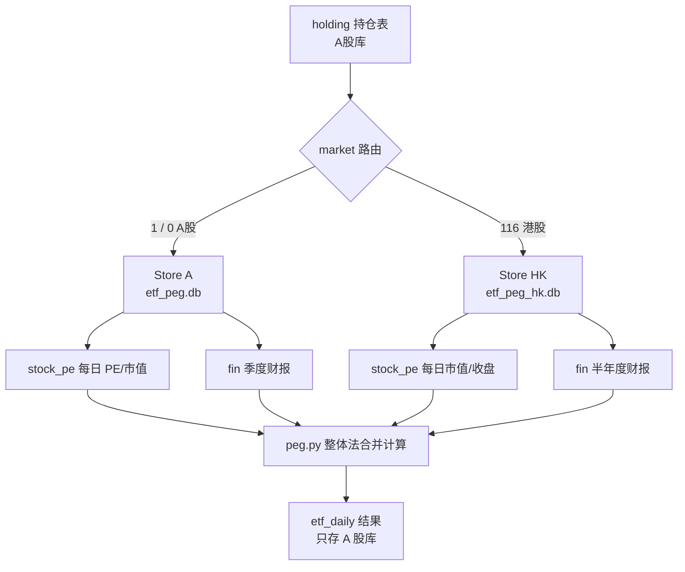

## 产品概述

在现有 ETF PEG 分析工具上补齐**港股数据源**，让持仓里含港股的基金（如沪港通/港股通主题 ETF、部分主动基金）能算准 PEG，而不是像现在这样把港股静默丢弃。

港股数据存入**独立于 A 股的新数据库**，计算时按持仓条目的市场标识分别到两个库取数，再合并计算。

## 核心功能

1. **港股行情与市值**

- 拉取港股每日收盘价与总股本，得到每日总市值
- 支持「一次性初始化全市场港股历史」与「每日增量补一天」

2. **港股财报**

- 拉取港股「股东应占溢利」（即归母净利润）与披露日
- 按港股实际的**半年度披露节奏**（06-30 / 12-31）构造 TTM，而非照搬 A 股季度口径

3. **港股 PE 与 PEG**

- PE = 当日总市值 ÷ 当日已披露的最新 TTM 归母净利润（与 A 股同一口径）
- 与 A 股成分股一起参与整体法加权：PE = Σw / Σ(w / PE_i)

4. **双库路由**

- 新增港股库（独立文件、独立初始化），A 股库结构完全不变
- 计算时按持仓条目的 market 字段自动选择数据源，对上层透明

5. **覆盖率修正**

- 修正当前「港股权重计入覆盖率分母却不参与计算」导致的系统性低估

6. **进度与可观测**

- 港股初始化提供 CLI 与 Web 两种入口，均带进度条与取消，支持断点续传

## 现状结论（已实测，决定了方案）

| 事实 | 证据 |
| --- | --- |
| 东财估值库**不覆盖**港股，`RPT_VALUEANALYSIS_DET` 无现成历史 PE | `filter=(SECUCODE="00700.HK")` 返回 `success:false / "返回数据为空" / code 9201` |
| 东财港股**行情可用**，有总股本与总市值，但无现成 PE | `push2/api/qt/stock/get?secid=116.00700` → `f84=9103161440`(总股本)、`f116=3874305508864`(总市值)、`f162=0`(PE 不提供) |
| 本地库港股数据为 0 | `stock_pe` 5 位代码数 = 0；`fin` 5 位代码数 = 0 |
| 港股被静默丢弃且污染覆盖率 | `peg.py:547` 标记 `status="oversea"` 后跳过；但 `peg.py:932` 的覆盖率分母仍计入港股权重 |
| 港股财报接口名**尚未确定** | `RPT_HKF10_FN_MAINFINADATA`、`RPT_HKF10_FIN_INCOME` 均返回 `"报表配置不存在"`；AKShare 文档确认存在「港股财务报表 / 港股财务指标」能力，可反查真实接口 |


**关键推论**：港股历史 PE 无法直接下载，必须**自己算** —— PE = 当日总市值 ÷ 当日已披露的最新 TTM 归母净利润。这与 A 股 `peg.py:912` 现有的 `pe = cell[1] / np_ttm` 是**同一个公式**，因此计算层改动可控。

## 技术栈

沿用现有：**纯 Python 标准库**（urllib / sqlite3 / http.server），不引入第三方依赖。新增接口用现有 `datasource.py` 的 HTTP 基建（限流 `_RATE_MIN_GAP=0.11`、多节点轮换、文件缓存）。

## 实现方案

### 1. 双库架构（核心设计）

把 `store.py` 从「模块级单一 DB_PATH」改造成**可实例化的 Store 类**，保持调用点零改动。

难点在于 `store.py:31` 的 `DB_PATH` 是模块常量、`_conn()`(L43) 是线程局部连接、`init()`(L54) 建表，而 `datasource.py:29` 在 import 时就调 `store.init()`。

方案：

- 抽出 `class Store(db_path, label)`，内部持有 `threading.local()`（key 含 db_path，天然支持多线程）
- 模块级建两个实例：`A = Store("etf_peg.db")`、`HK = Store("etf_peg_hk.db")`
- 用 **PEP 562 模块级 `__getattr__`** 把 `store.xxx(...)` 自动委派到 `A.xxx(...)`，约 5 行代码覆盖全部 40+ 个函数，**避免写 40 个包装函数**，也保证 A 股路径零回归
- `init()` 时同时初始化两个库



**为什么结果表仍然只放 A 股库**：`etf_daily` 是基金层面的结果，一只基金的 PEG 混合了 A 股与港股，拆开存反而要跨库 join。港股库只存**市场级数据**（个股行情、财报），不存基金持仓与结果。

### 2. 表结构复用

港股库建**相同 schema**，`stock_pe` / `fin` / `pe_fetch_log` / `fin_period` 四张表被使用；`holding` / `etf_daily` / `etf` 不创建也不使用（在 README 标注）。

好处：`pe_dates()` / `pe_pending()` / `pe_coverage()` / `load_stock_pe()` / `build_pit_timelines()` 全部**无需改动**即可作用于港股库。

### 3. TTM 口径适配（容易踩坑）

现有 `ttm_required_periods()`(`datasource.py:808`) 的公式是：

```
TTM(q) = 本期累计(q) + 上年年报 - 去年同期累计(q)
```

这个公式**对半年度同样成立**（H1(2026) + FY2025 − H1(2025)），所以**不需要改公式**。

真正的适配点在 `build_pit_timelines()`(`peg.py:138`)：港股没有 03-31 / 09-30 两期，遍历到这两期时 `row=None → ok=False → 跳过`，**天然自适配**，无需改代码。

需要额外处理的：

- 港股财年未必是 12-31（如 3/31 年结），这类公司 TTM 会算错 → 记录 `fiscal_year_end` 并在界面标注，首版作为已知限制
- 港股财报币种可能是 HKD / USD / RMB，只要市值与净利同币种 PE 就正确 → 记录 `currency`，币种不一致时告警
- **不需要换汇**：整体法 `PE = Σw / Σ(w/PE_i)` 中 w 是基金披露的人民币权重占比，PE 无量纲

### 4. 抓取层

新增 `etf_peg/hk.py`，与 A 股抓取逻辑物理隔离：

| 能力 | 用途 | 备注 |
| --- | --- | --- |
| `fetch_hk_codes()` | 全市场港股代码清单（约 2600 只） | 东财港股行情列表 |
| `fetch_hk_kline(code, start)` | 每日收盘价 | push2his，`secid=116.xxxxx` |
| `fetch_hk_share(code)` | 总股本 | push2 `f84` |
| `fetch_hk_financials(period)` | 股东应占溢利 + 披露日 | 接口名待 Spike 确认 |
| `ensure_hk_market_snapshot()` | 当日全市场快照（实时分析用） | 约 26 页，约 12 秒 |


共享 HTTP 基建通过新增 `etf_peg/net.py` 做薄转发（`http_get = _ds.http_get` 之类），**不动 `datasource.py` 现有实现**，把改动面降到最小。

### 5. 计算层改动（`peg.py`）

在 `analyze_etf`（L411）与 `backfill_etf`（L736）中：

- 把 `codes` 按市场拆成 A/HK 两组，分别调 `store.A` / `store.HK` 取 PE 与财报，再合并成同一 dict（A 股 6 位、港股 5 位，**无代码冲突**）
- 财报按 `period` 合并：`{**A.load_fin_subset(p, a_codes), **HK.load_fin_subset(p, hk_codes)}`
- 港股 PE 用与 A 股相同的 `mktcap / np_ttm`
- **修正覆盖率**：`peg.py:932` 的分母改为「可计算股票的权重」（A 股有数据 或 港股有数据 或 确实无数据如美股则排除），并在结果里增加 `n_hk` / `hk_weight` 字段

## 实施要点（防回归）

- **`pe_coverage` 分母口径**：`latest_market_pe_date()` 已修过一次（只取最近一天会误判），港股库条数阈值不能沿用 3000（港股全市场约 2600 只），需按市场参数化
- **限流是全局的**：`_RATE_MIN_GAP` 在 `datasource.py:60` 是模块级单例，港股抓取必须复用同一个节流器，否则叠加起来会被东财掐连接（历史上有过「卡几小时」的教训）
- **A 股路径零回归**：`store.__getattr__` 委派 + Spike 先行，每阶段跑一次 `510300` 全区间回填做回归基准（当前 0.92 秒）
- **断点续传**：港股初始化复用 `pe_fetch_log` 水位机制，与 A 股一致

## 工作量与体积估算

| 项 | 估算 |
| --- | --- |
| 港股只数 | 约 2,600 只 |
| 首次初始化耗时 | 日 K 约 2600 次 + 股本约 2600 次 + 财报 ≈ **40~60 分钟** |
| 港股库体积 | 2600 × 约 2100 交易日 ≈ 550 万行 ≈ **0.7 GB** |
| 每日增量 | 1 次全市场快照，约 12 秒 |
| 实时分析新增耗时 | 港股快照约 12 秒（可缓存当天） |


## 验收标准（每阶段必跑）

1. Spike：`docs/hk_api.md` 里每个接口都有真实响应样本与字段说明
2. 双库：`run.py --store` 同时显示两个库；`510300` 回填 ≤ 2 秒（与当前 0.92s 持平）
3. 抓取：港股库写入 00700 的数据，市值误差 &lt; 1%（对照 push2 实时 f116）
4. 计算：含港股基金（如持仓里有 00700 的那只）覆盖率上升、PEG 有值
5. 端到端：港股初始化跑 5 分钟后中断再续，进度不回退

## 目录结构

```
D:\行情分析\
├── run.py                      [MODIFY] 新增 --init-hk；--store 增加港股库状态
├── README.md                   [MODIFY] 港股章节、双库说明、已知限制
├── docs\
│   └── hk_api.md               [NEW]    Spike 产出：港股各接口的 URL/字段/限流表现
├── web\
│   └── index.html              [MODIFY] 港股初始化入口（按钮/进度条/取消/覆盖度）
└── etf_peg\
    ├── net.py                  [NEW]    共享 HTTP 薄转发层，供 hk.py 复用限流与缓存
    ├── hk.py                   [NEW]    港股抓取：代码清单/日K/股本/财报/当日快照/初始化
    ├── store.py                [MODIFY] Store 类化 + A/HK 双实例 + __getattr__ 向后兼容
    ├── datasource.py           [MODIFY] 增加 is_hk()/hk_secid()；明确 ensure_market_pe 只管 A 股
    ├── peg.py                  [MODIFY] 市场路由、双库取数合并、覆盖率分母修正、n_hk 字段
    └── server.py               [MODIFY] job kind=inithk、/api/hk-coverage 接口
```

## 关键接口约定

```python
# store.py —— 双库入口；模块级 store.xxx 仍自动路由到 A 股库
class Store:
    def __init__(self, db_path: str, label: str): ...
    # 原有全部函数原样成为方法

A: Store   # etf_peg.db
HK: Store  # etf_peg_hk.db

def market_of(market: Optional[str], code: Optional[str]) -> Store: ...
```

```python
# hk.py —— 与 A 股 init_all_stock_pe 同构，便于复用前端进度条
def init_all_hk(start_date=None, on_progress=None, cancel=None) -> dict
def ensure_hk_market_snapshot(max_lag_days=2, force=False) -> Optional[str]
def fetch_hk_financials(period: str, force=False, on_progress=None) -> Dict[str, dict]
```